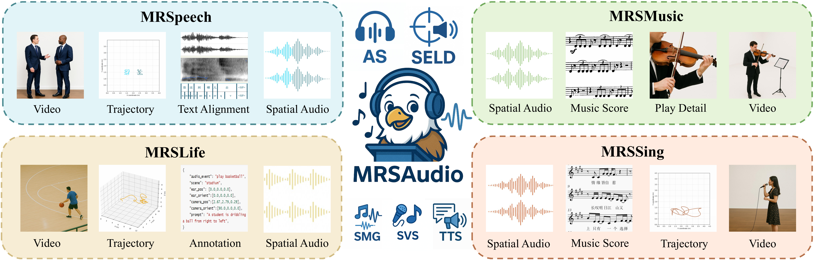

# MRSAudio: A Large-Scale Multimodal Recorded Spatial Audio Dataset with Refined Annotations

#### Wenxiang Guo*, Changhao Pan*, Zhiyuan Zhu*, Xintong Hu*, Yu Zhang*, Zhou Zhao | Zhejiang University

<!-- Dataset and evaluation code of [MRSAudio (NeurIPS 2025)](): A Large-Scale Multimodal Recorded Spatial Audio Dataset with Refined Annotations -->

<!-- []()  -->

[](https://mrsaudio.github.io/)
[](https://huggingface.co/datasets/verstar/MRSAudio)

We present **MRSAudio**, a large-scale multimodal recorded spatial audio dataset containing **binaural/FOA audio**, **scripts**, **videos**, **geometric poses**, and **textual prompts**.

This repository provides **data processing and evaluation code**, along with benchmark setups for multiple spatial audio tasks.
For qualitative samples and demos, please visit our [Demo Page](https://mrsaudio.github.io).



---

## Dataset

### Download

Click [](https://huggingface.co/datasets/verstar/MRSAudio) to access the **full dataset**, including:

* Binaural & FOA audio
* Text scripts & transcripts
* Video recordings
* Frame-level 3D positions & orientations
* Textual prompts

**By using MRSAudio, you agree to the terms outlined in our [license](dataset_license.md).**

### Data Structure

The dataset follows a hierarchical structure:

Each top-level folder contains a set of dramas. Each folder contains a subfolder with cut WAV files, an MP4 video file, and a JSON file containing all annotation information. Additionally, the geometric_pose subdirectory stores NumPy (.npy) sequences—listener‑centric 3D positions, head-orientation quaternions, and radial velocities with respect to the left and right ears. These sequences are aligned at the frame level and generated with a 48 kHz sample rate and a 256-sample hop size.

### Data Processing

For detailed data preprocessing and inference instructions, see [data_process](./data_process/README.md).

## Code for benchmarks

We provide benchmark setups and evaluation scripts for several spatial audio tasks:

---

### 1. Audio Spatialization

The code for our benchmarks for [Audio Spatialization](./Audio_Spatialization/README.md).

### 2. End-to-End Spatial Speech Generation

For end-to-end spatial speech generation, refer to [ISDrama](https://github.com/AaronZ345/ISDrama).

### 3. Sound Event Localization and Detection (SELD)

The code for our benchmarks for [SELD](./audio-visual-seld-dcase2023/README.md). 

### 4. Monophonic Singing Voice and Music Generation

For singing voice generation, refer to [TechSinger](https://github.com/gwx314/TechSinger).
For music generation, see [MAA-2](./MAA-2/README.md).

---

## Citation

If you find this dataset or code useful for your research, please cite our work:

```bib
@article{guo2025mrsaudio,
  title={MRSAudio: A Large-Scale Multimodal Recorded Spatial Audio Dataset with Refined Annotations},
  author={Guo, Wenxiang and Pan, Changhao and Zhu, Zhiyuan and Hu, Xintong and Zhang, Yu and Zhao, Zhou},
  journal={arXiv preprint arXiv:2510.10396},
  year={2025}
}
```

---

##  Disclaimer

Any organization or individual is prohibited from using any technology mentioned in this paper to generate someone's speech without his/her consent, including but not limited to government leaders, political figures, and celebrities. If you do not comply with this item, you could be in violation of copyright laws.

## Relevant Projects

Many thanks to:
- [Make-An-Audio 2](https://github.com/bytedance/Make-An-Audio-2)
- [STARSS23](https://github.com/sony/audio-visual-seld-dcase2023)
- [BinauralGrad](https://github.com/microsoft/NeuralSpeech/tree/master/BinauralGrad)
- [WhisperX](https://github.com/m-bain/whisperX )


